# 🖥 نظام نوبت‌دهی آرایشگاه | Nobino

> یک پلتفرم SaaS کامل بر پایه هوش مصنوعی صوتی، سیستم مالی چندسطحی و ۱۵ درگاه پرداخت ایرانی.

---

## ✅ چکیده / چشم‌انداز

پلتفرم **Nobino** به هر آرایشگاه یک **صفحه و ساب‌دامین مجزا** می‌دهد. مشتری می‌تواند با **میکروفون** به زبان فارسی نوبت بگیرد؛ سیستم گفتار را به متن تبدیل می‌کند، نوبت را در دیتابیس ثبت می‌کند و در زمان مقرر **پیامک یادآوری** می‌فرستد.

هر آرایشگاه و نماینده و سوپرادمین یک **پنل مالی دقیق** دارد که درآمد، کمیسیون و تراکنش‌ها را شفاف نشان می‌دهد. پکیج‌ها از طریق **۱۵ درگاه پرداخت ایرانی** فروخته می‌شوند و کل سیستم قابلیت **افزودن به وب‌اپ‌های تلگرام / ایتا / بله** را دارد.

---

## 🧱 معماری کلی

```
┌───────────────────────────────────────────────────────────┐
│                    Client (Next.js / React)                │
│  صفحه عمومی سالن | پنل مشتری | پنل آرایشگر | پنل نماینده  │
│                        پنل ادمین | وب‌اپ پیام‌رسان‌ها          │
└───────────────┬───────────────────────────────────────────┘
                │  REST API (Route Handlers)
┌───────────────▼───────────────────────────────────────────┐
│                Layer: API / Business Logic                  │
│  Auth(OTP) | نوبت | استخراج صوت (Whisper) | پیامک | مالی  │
│                موتور پرداخت (15 Adapter)                    │
└───────────────┬───────────────────────────────────────────┘
                │  Prisma ORM
┌───────────────▼───────────────────────────────────────────┐
│              PostgreSQL database (Neon/Supabase)            │
└───────────────────────────────────────────────────────────┘
```

**تکنولوژی:**
- **Next.js 15 (App Router)** — فرانت و بک‌اند یکپارچه
- **Tailwind CSS** — استایل
- **Prisma + PostgreSQL** — دیتابیس
- **OpenAI Whisper** — تبدیل گفتار فارسی به متن
- **Zod** — اعتبارسنجی داده
- **jose / jwks-rsa** — JWT (سشن)
- **Kavenegar / SMS.ir / FarazSMS** — سرویس پیامک
- **Vercel** — استقرار
- **S3 / Vercel Blob** — ذخیره‌سازی فایل (گالری و صوت)

---

## 🎯 نقشه راه فازبندی‌شده

### فاز ۰ — پایه‌گذاری
- [ ] مقداردهی اولیه Next.js + Tailwind + TypeScript + ESLint + Prettier
- [ ] تنظیم Prisma و اتصال PostgreSQL
- [ ] ساختار پوشه‌ها (app / components / lib / middleware)
- [ ] پیکربندی متغیرهای محیطی (`.env` + `.env.example`)
- [ ] اسکریپت‌های توسعه (dev / seed / prisma)

### فاز ۱ — مدل داده (Prisma Schema)
- [ ] مدل User / Role (مشتری، آرایشگر، نماینده، ادمین)
- [ ] مدل Salon (صفحه و ساب‌دامین مجزا)
- [ ] مدل Service ، Appointment ، OpeningHours ، Gallery
- [ ] مدل VoiceCall (ضبط صوت و متن استخراج‌شده)
- [ ] مدل Financial: Wallet ، Transaction ، Commission ، Payout
- [ ] مدل Package و Subscription و Order / Payment
- [ ] مدل OTP (برای احراز هویت)
- [ ] ایندکس‌گذاری مناسب (برای جستجوی سریع)

### فاز ۲ — احراز هویت (OTP)
- [ ] ثبت‌نام / ورود با شماره موبایل
- [ ] ارسال کد OTP از طریق پیامک
- [ ] اعتبارسنجی OTP و صدور JWT
- [ ] میدل‌ور `auth` و `role` و `tenant`
- [ ] بازیابی پروفایل / ویرایش

### فاز ۳ — هوش مصنوعی صوتی (STT)
- [ ] ضبط صوت در مرورگر (MediaRecorder)
- [ ] آپلود فایل صوتی به دیتابیس/فضای ابری
- [ ] فراخوانی OpenAI Whisper (API) برای `transcribe` فارسی
- [ ] استخراج اطلاعات نوبت از متن (تاریخ، ساعت، خدمت، نام)
- [ ] تأیید اطلاعات توسط مشتری پیش از ثبت نهایی
- [ ] ذخیره رسمی نوبت + ارسال پیامک تأیید

### فاز ۴ — نوبت‌دهی و اطلاع‌رسانی
- [ ] در دسترس بودن آرایشگران و خدمات
- [ ] ثبت نوبت (دستی و صوتی)
- [ ] جلوگیری از تداخل زمانی
- [ ] پنل آرایشگر: مدیریت نوبت‌ها (تأیید/لغو/تعویض)
- [ ] ارسال پیامک یادآوری در زمان مقرر (Cron / Vercel Cron)

### فاز ۵ — صفحه و ساب‌دامین سالن
- [ ] ساب‌دامین داینامیک (مانند `salon.nobino.ir`)
- [ ] صفحه عمومی سالن: درباره، خدمات، گالری، نوبت‌گیری
- [ ] بلیط/کوپن سفارشی
- [ ] لینک اختصاصی برای نوبت

### فاز ۶ — سیستم مالی (چندسطحی)
- [ ] کیف پول (Wallet) برای هر نقش
- [ ] مدیریت تراکنش‌ها (واریز/برداشت/کمیسیون)
- [ ] محاسبه کمیسیون نمایندگان (درصدی)
- [ ] تسویه حساب آرایشگران
- [ ] گزارش‌گیری مالی و نمودار
- [ ] داشبورد مالی سوپرادمین

### فاز ۷ — پکیج و فروش
- [ ] تعریف پکیج‌ها (ماهانه/سالانه، امکانات)
- [ ] سبد خرید و سفارش
- [ ] اتصال به موتور پرداخت

### فاز ۸ — موتور پرداخت (۱۵ درگاه)
- [ ] طراحی Interface اتحادی `PaymentGateway`
- [ ] پیاده‌سازی Adapter برای هر درگاه
- [ ] سبک Sandbox/Mock برای تست
- [ ] وب‌هوک پردازش نتایج پرداخت
- [ ] تراکنش‌ها + صنخورد (Reconciliation)
- [ ] درگاه‌ها: زرین‌پال، ملت، سامان، پارسیان، پاسارگاد، آسان‌پرداخت، ایران‌کیش، به‌پرداخت، سداد، مبناکارت، سی‌تاب، پرداخت‌نت، پی‌اس‌پی (PSP)، ونکی، نکست‌پی ...

### فاز ۹ — وب‌اپ پیام‌رسان‌ها
- [ ] وب‌اپ تلگرام (Telegram WebApp)
- [ ] وب‌اپ ایتا (Eitaa)
- [ ] وب‌اپ بله (Bale)
- [ ] مشارکت در ساختار Next.js (ابزارک)

### فاز ۱۰ — بهینه‌سازی و استقرار
- [ ] SEO و متا تگ‌ها برای هر سالن
- [ ] کشینگ (ISR / مسیرهای ایستا)
- [ ] تست واحد (Vitest) + تست انتها به انتها (Playwright)
- [ ] استقرار روی Vercel + تنظیم دامنه‌ها
- [ ] مانیتورینگ (Sentry) و لاگ

---

## 🏛 ساختار پوشه‌ها

```
Nobino/
├─ app/
│  ├─ (marketing)/           تاریخ صفحه اصلی/بازاریابی
│  ├─ (public)/[salon]/      ساب‌دامین سالن
│  ├─ (dashboard)/            پنل‌ها (admin/agent/salon/customer)
│  ├─ api/                   Route Handlers (REST)
│  ├─ layout.tsx / globals.css
├─ components/
├─ lib/
│  ├─ prisma.ts
│  ├─ auth/ (jwt, otp, middleware)
│  ├─ ai/ (whisper, parser)
│  ├─ sms/ (senders)
│  ├─ payments/ (gateways/*, engine)
│  ├─ financial/
│  ├─ utils/
├─ prisma/
│  ├─ schema.prisma
│  ├─ seed.ts
├─ public/
├─ .env.example
├─ ROADMAP.md
```

---

## 🧭 نمودار فازها (Milestones)

```mermaid
flowchart LR
    A[فاز 0: پایه‌گذاری] --> B[فاز 1: مدل داده]
    B --> C[فاز 2: احراز هویت OTP]
    C --> D[فاز 3: هوش صوتی Whisper]
    D --> E[فاز 4: نوبت‌دهی + پیامک]
    E --> F[فاز 5: ساب‌دامین سالن]
    F --> G[فاز 6: سیستم مالی]
    G --> H[فاز 7: پکیج]
    H --> I[فاز 8: ۱۵ درگاه پرداخت]
    I --> J[فاز 9: وب‌اپ پیام‌رسان‌ها]
    J --> K[فاز 10: استقرار Vercel]
```



---

## 🧪 تصمیمات فنی کلیدی

| موضوع | تصمیم | دلیل |
|---|---|---|
| دیتابیس | PostgreSQL + Prisma | سازگاری کامل با Vercel و مدل قوی |
| احراز هویت | موبایل + OTP | بازار ایران، بدون نیاز به ایمیل در ورود |
| STT | OpenAI Whisper | دقت بالا در فارسی و API ساده |
| پیامک | Kavenegar / SMS.ir | پشتیبانی قوی OTP و یادآوری |
| پرداخت | ۱۵ Adapter + Sandbox | آماده برای اتصال واقعی هر زمان |
| میزبانی | Vercel + Neon Postgres | استقرار آسان ویا رایگان |
| Cron | Vercel Cron | ارسال پیامک یادآوری خودکار |
| فایل | Vercel Blob | گالری و صوت بدون مدیریت سرور |

---

## 🚀 نتیجه نهایی (Definition of Done)

- [ ] یک سیستم کامل multi-tenant برای هزاران سالن
- [ ] ثبت نوبت با صدای فارسی در کمتر از ۱۰ ثانیه
- [ ] پنل مالی دقیق و چندسطحی (آرایشگر/نماینده/سوپرادمین)
- [ ] فروش پکیج با ۱۵ درگاه پرداخت (قابل تعویض)
- [ ] وب‌اپ قابل اضافه شدن به تلگرام/ایتا/بله
- [ ] استقرار کامل روی Vercel با دامنه اختصاصی هر سالن
